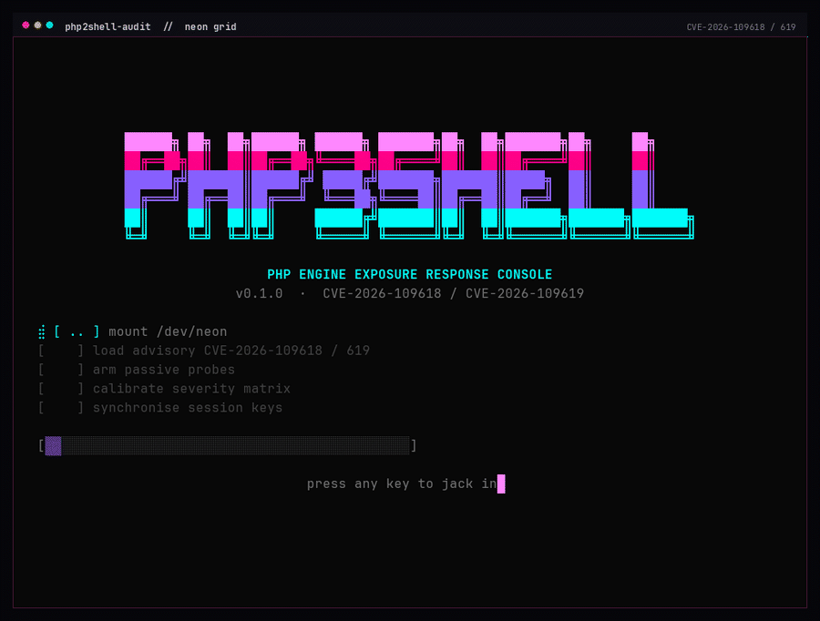

# php2shell-audit

**Exposure scanner, patch verifier and threat hunter for the October 2026 PHP
`php2shell` vulnerabilities (CVE-2026-109618 / CVE-2026-109619).**

`p2s` answers two questions in one zero-dependency Go binary:

1. **Am I exposed?** It inventories PHP binaries, running workers, distro
   packages, containers and remote endpoints, verifies the patch level against
   the published fixed releases, and evaluates the runtime configuration that
   makes the bugs reachable.
2. **Was I exploited?** It parses web/PHP/system logs, scores web roots for
   webshells, inspects session files, checks the live process tree for shells
   and egress, and looks for cron/systemd/SSH-key persistence. Evidence can be
   exported with a SHA-256 manifest.

An optional, authorization-gated `offense` mode validates the two primitives
with bounded probes. It does not weaponise them; see
[`p2s offense`](#p2s-offense--authorized-validation).

```
$ p2s scan --local
php2shell-audit 0.1.0  2026-10-23T04:00:48Z
mode: scan
SUMMARY: 0 critical  2 high  3 medium  0 low  1 info   (6 total)

Inspected 5 PHP target(s): 3 vulnerable, 0 end-of-life, 0 patched, 2 unverified.
Upgrade to 8.5.12, 8.4.27, 8.3.36 or 8.2.35 (or a vendor backport) and restart
every worker. Do not rely on application-level patches.

TARGETS
  NAME                                    KIND     SAPI   VERSION  STATUS
  binary:/usr/bin/php8.4                  binary   cli    8.4.26   vulnerable
  packages: php8.4-bcmath +11 more ...    package  -      8.4.26   vulnerable
  host:web01                              host     fpm    8.4.26   vulnerable
...
```

> **Scope.** `scan` and `hunt` are defensive: remote checks are passive GET
> requests (plus optional operator-supplied paths such as an authenticated
> `phpinfo` page). The optional `offense` mode adds **authorized, bounded
> validation** of the two CVEs behind a scope file and an audit trail. It still
> contains no exploit payload, no weaponised RCE chain, no reverse shell and no
> persistence. See [Authorization and safety](#authorization-and-safety).

---

## Why this incident is different

The bugs are in the **PHP engine**, below application code:

| CVE | Primitive | Preconditions observed publicly |
| --- | --- | --- |
| **CVE-2026-109618** | Memory corruption after an out-of-memory `longjmp()` path; can be turned into pre-auth RCE and a worker-memory disclosure | finite `memory_limit`; a request large enough to exhaust it; **mod_php** is the strongest demonstrated chain |
| **CVE-2026-109619** | Stale cross-request global/backtrace/OPcache state | a reused worker (FPM or mod_php); `session.upload_progress` and/or `fatal_error_backtraces` on PHP 8.5 |

Consequences for defenders:

- A patched CMS, WAF signatures for application bugs, or `disable_functions`
  do not fix this. **Only a patched PHP build (or a vendor backport) does.**
- The exploit can run before the application is entered, so application logs
  and access logs may be clean. Absence of signals is not proof of safety.
- The memory-disclosure primitive can leak credentials and session data even
  when code execution fails. Rotation matters as much as patching.
- Failed attempts often leave high-signal engine artefacts: startup OOMs and
  worker crashes.

### Fixed releases

| Branch | Fixed version | Notes |
| --- | --- | --- |
| 8.5 | **8.5.12** | also set `fatal_error_backtraces=0` until patched |
| 8.4 | **8.4.27** | |
| 8.3 | **8.3.36** | |
| 8.2 | **8.2.35** | |
| 8.1 and older | none | EOL; distro backports possible, verify the changelog |
| 8.6 / RCs | unverified | treat as affected until the vendor publishes |

Affected range stated by the advisory: **PHP 5.4 through 8.5.11**.

---

## Install

Requires Go 1.27 or newer. No third-party modules.

```sh
git clone https://github.com/darkLabz001/php2shell-audit
cd php2shell-audit
make build          # -> bin/p2s
sudo make install   # -> /usr/local/bin/p2s

# Optional: install to ~/.local/bin and alias "php" to the console
make install-alias
```

Or run it without installing:

```sh
go run ./cmd/p2s scan --local
```

Cross-compile a static binary for a fleet host:

```sh
GOOS=linux GOARCH=amd64 CGO_ENABLED=0 go build -trimpath -o p2s ./cmd/p2s
```

---

## Quick start

```sh
# 0. Open the interactive console (also available as `php` after install-alias)
php                 # or: p2s tui, or just p2s on a terminal

# 1. What is installed and running on this host?
sudo p2s scan --local --web-root /var/www --format json --output scan.json

# 2. What is exposed behind the load balancer?
p2s scan --targets-file targets.txt --format sarif --output exposure.sarif

# 3. Was anything exploited in the last week?
sudo p2s hunt --logs /var/log --web-root /var/www --live \
    --since 7d --evidence ./case-$(date +%F)

# 4. Give the SOC ready-made detections.
p2s rules --format all --output ./detections

# 5. Validate an authorized lab endpoint (scope-gated, audited)
p2s offense --authorize scope.json --target http://127.0.0.1:8081/
```

`--fail-on critical` (or `high`, `medium`, ...) makes any command exit **2** when
the threshold is met, so it drops straight into CI or a monitoring cron job.

---

## Interactive console

`p2s tui` opens a full-screen cyberpunk console that wraps every operation. It
is drawn with raw ANSI escape sequences and the Go standard library, so the
single binary keeps its zero-dependency footprint.



*Demo: `php` → local inventory → findings → targets → dossier → manual.*

| Operation | Equivalent command |
| --- | --- |
| LOCAL INVENTORY | `p2s scan --local` |
| REMOTE PROBE | `p2s scan --target URL` |
| CONTAINER SWEEP | `p2s scan --docker` |
| LOG HUNT | `p2s hunt --logs PATH` |
| LIVE RESPONSE | `p2s hunt --live` |
| WEBSHELL SWEEP | `p2s hunt --web-root DIR --all-files` |
| SIGNATURE FORGE | `p2s rules --format all` |
| OFFENSE RANGE | `p2s offense --authorize scope.json --target URL` |

The console's OFFENSE RANGE runs the **safe** validation probes only. The
disruptive pressure probe is deliberately CLI-only. It requires a scope file
and typing `AUTHORIZE` before any request is sent.

Scan and hunt results open in a browser with **FINDINGS**, plus **TARGETS**
and **NOTES** tabs when the report contains them. `enter` opens the full
dossier for a finding, `e` writes the current report to
`out/tui-<mode>-<timestamp>.json`, and the rules screen writes detections under
`out/detections`.

| Key | Action |
| --- | --- |
| `↑` `↓` / `j` `k` | move the cursor or scroll |
| `enter` | execute the operation / open a dossier |
| `tab` / `←` `→` | switch result tabs |
| `1`-`9`, `0` | jump to a menu operation (0 is the tenth) |
| `page up` / `page down` / `space` | scroll a document |
| `e` | export |
| `esc` | abort a prompt or go back |
| `?` | open the manual |
| `q` | leave the console |

The console requires a real terminal. Redirected output is refused with a
pointer to the non-interactive commands. `NO_COLOR=1` or `TERM=dumb` disables
the palette while keeping the layout.

### The `php` alias

```sh
make install-alias   # installs ~/.local/bin/p2s and appends to ~/.bash_aliases
source ~/.bash_aliases
php                  # opens the console
```

The alias is interactive-shell only: scripts, `#!/usr/bin/env php` and the
scanner's own `php -v` subprocess still reach the real PHP binary. Remove the
guarded block from `~/.bash_aliases` (or run `unalias php`) to restore the PHP
CLI prompt.

---

## Command reference

### `p2s tui` — interactive console

```sh
p2s tui          # open the neon console
p2s              # same thing when stdin/stdout are a terminal
php              # after make install-alias
```

No flags. See [Interactive console](#interactive-console).

### `p2s scan` — exposure and patch verification

```sh
p2s scan [--local] [--docker] [--target URL ...] [--targets-file FILE]
         [--web-root DIR ...] [--ini FILE ...] [--path PATH ...]
         [--timeout 8s] [--insecure]
         [--format text|json|jsonl|sarif] [--output FILE] [--fail-on SEV]
```

| Flag | Meaning |
| --- | --- |
| `--local` | Inventory this host. This is the default when no other mode is given. |
| `--docker` | Inspect running containers through the local `docker` CLI, including floating tags. |
| `--target URL` | Passive check of one remote endpoint. Repeatable; bare hosts are tried as HTTPS then HTTP. |
| `--targets-file FILE` | One URL per line; `#` comments and blank lines ignored. |
| `--web-root DIR` | Search `.user.ini` / `.htaccess` for per-directory overrides. Repeatable. |
| `--ini FILE` | Read a specific `php.ini` or FPM pool file. Repeatable. |
| `--path PATH` | Extra path to GET on each remote target (for example an authenticated `phpinfo.php` you own). |
| `--timeout` | Per-operation timeout. |
| `--insecure` | Skip TLS verification for remote targets only. |

The local scanner reads `php -i`, process command lines, `php -v`, distro
package databases (`dpkg`, `rpm`, `apk`), package changelogs (for backports),
and effective ini/FPM/Apache configuration. Packages are grouped per branch so
a Debian host with twelve `php8.4-*` packages produces one package finding, not
twelve. The running worker is reported separately because that is the build
that actually serves requests.

The remote scanner trusts only version signals in `X-Powered-By`,
`X-PHP-Version`, `Server`, `X-Generator`, a reachable `phpinfo()` page, or a
body that clearly looks like `phpinfo`. It does not send malformed requests and
does not try to trigger the bug.

### `p2s hunt` — threat hunting and triage

```sh
p2s hunt [--logs PATH ...] [--web-root DIR ...] [--session-path DIR ...] [--live]
         [--since 2026-10-17T00:00:00Z] [--until TIME]
         [--all-files] [--min-file-score 6] [--max-events 500000]
         [--large-body 2097152] [--burst 10] [--burst-window 5m]
         [--evidence DIR]
         [--format text|json|jsonl|sarif] [--output FILE] [--fail-on SEV]
```

`--since` accepts RFC3339, `YYYY-MM-DD`, `today`, `yesterday`, `72h`, `7d` or
`1w`. The default is **2026-10-17T00:00:00Z**, the first day public exploitation
attempts were reported.

Log parsing auto-detects:

- Apache/Nginx **access logs** (combined and common formats)
- Apache **error logs** (`[Thu Oct 17 ...] [core:error] ...`)
- Nginx **error logs**
- PHP-FPM / PHP **error logs**
- **syslog** lines
- **JSON/JSONL** records with common field names (`timestamp`, `client_ip`,
  `method`, `path`, `status`, `content_length`, `set_cookie`, `request_body`, ...)
- gzip-compressed files and rotated files in a directory

#### What it detects

| ID | Signal | Why it matters | Default severity |
| --- | --- | --- | --- |
| `P2S-HUNT-001` | `Allowed memory size ... exhausted ... in Unknown on line 0` | OOM during request startup is the CVE-2026-109618 trigger, before application code | high |
| `P2S-HUNT-002` | `AH00052 ... Segmentation fault`, `SIGSEGV`, `SIGABRT`, `exited on signal 11/6` | failed exploitation commonly kills the worker | medium |
| `P2S-HUNT-003` | `POST/PUT/PATCH` with a multi-megabyte body | oversized form bodies are the delivery vehicle | medium |
| `P2S-HUNT-004` | `PHP_SESSION_UPLOAD_PROGRESS` in a request | pre-application upload-progress path for CVE-2026-109619 | medium |
| `P2S-HUNT-005` | `PHPSESSID` > 256 bytes or heavily percent-encoded in `Set-Cookie` | worker-memory disclosure | high |
| `P2S-HUNT-007` | several independent signals from one source | correlation: the shape of an active attempt | critical |
| `P2S-HUNT-008` | startup OOM plus an oversized request from one source | strong CVE-2026-109618 chain | high |
| `P2S-HUNT-012` | weighted webshell score in a PHP file | post-exploitation file | high |
| `P2S-HUNT-013` | `.user.ini` / `.htaccess` with `auto_prepend_file` | a known persistence and code-redirect trick | critical |
| `P2S-HUNT-014` | PHP code inside a `sess_*` file | webshell written through a session path | critical |

In-script OOMs (the common "this page used too much memory" case) are suppressed
by default because they are usually application bugs. They are still available
with `--include-noise` at the API level.

#### Live host checks (`--live`)

- PHP/Apache/FPM workers with shell, transfer-tool or interpreter children
  (`sh`, `bash`, `nc`, `socat`, `curl`, `wget`, `python`, `perl`, ...)
- Outbound sockets owned by web-worker PIDs to non-standard ports
- Cron entries, systemd units, `rc.local`, `ld.so.preload`, and
  `authorized_keys` files created inside the analysis window
- Default session directories (`/var/lib/php/sessions`, ...)

Run it as root to see every process and file. Unreadable paths are reported as
warnings, never silently skipped.

#### Evidence export

`--evidence DIR` writes:

| File | Content |
| --- | --- |
| `findings.json` | All findings and the summary |
| `events.jsonl` | Every detector event before aggregation |
| `matches.log` | Human-readable review sheet |
| `manifest.json` | SHA-256 of each evidence file |

The directory is created `0700` and files are written `0600`.

### `p2s rules` — detection content

```sh
p2s rules --format all --output ./detections
p2s rules --format sigma            # stdout
p2s rules --list                    # file names only
```

Formats: `sigma`, `modsecurity`, `nginx`, `yara`, `kql`, `splunk` or `all`.
Output includes five Sigma rules, ModSecurity/Coraza request limits and
high-signal flags, an nginx limit snippet, YARA rules for webshells and session
injection, Sentinel KQL and Splunk SPL.

These are **starting points**. Tune thresholds to your traffic, run in detect
mode first, and remember that the proxy rules are partial mitigations, not a
fix.

### `p2s offense` — authorized validation

`offense` is the only active mode in the tool. It is opt-in, scope-gated and
audited. It stops at validation signals: no exploit payload, code execution,
reverse shell, webshell, credential extraction or persistence.

```sh
cp docs/authorization.example.json scope.json   # fill in case, owner, target, expiry
p2s offense --authorize scope.json --target http://127.0.0.1:8081/

# Opt-in disruptive CVE-2026-109618 pressure probe (authorized lab only)
p2s offense --authorize scope.json --target http://127.0.0.1:8081/ \
    --oom-body 8MiB --acknowledge-disruption
```

The scope file is an operator attestation kept with the engagement record:

```json
{
  "case_id": "LAB-2026-001",
  "operator": "your name or team",
  "expires": "2026-12-31T23:59:59Z",
  "targets": ["http://127.0.0.1:8081/"],
  "allow_public": false,
  "acknowledge_disruption": false
}
```

| Probe | Request | What it can tell you |
| --- | --- | --- |
| `109618` preflight | one passive GET | version and patch status; never triggers the bug |
| `109618` pressure | one bounded urlencoded POST, opt-in | timeout, connection drop, 5xx/OOM signature, or 413 rejection |
| `109619` canary | two tiny multipart uploads plus one GET on a unique `PHPSESSID` | whether both progress canaries persist across worker requests |

The pressure probe can restart a worker. It runs only when the preflight
confirms a vulnerable or end-of-life build, and it requires
`acknowledge_disruption: true` in the scope **and** `--acknowledge-disruption`
on the command line.

Guardrails enforced before the first request:

- scheme, host, port and path must be covered by a scope URL;
- the scope needs a case id, operator, future expiry and at least one target;
- public addresses need `allow_public: true` and `--allow-public`;
- 1 KiB minimum, 64 MiB maximum, one pressure request, redirects disabled;
- no retries, no proxy and no public-address default;
- every run appends JSONL to `out/offense-audit.jsonl` (mode `0600`);
- authorization failures abort before anything is sent.

Findings use the `P2S-OFF-*` IDs and the `validation` category. A green result
is not proof of safety, and a canary or timeout is not proof of code execution.
Correlate with server logs and keep the audit trail.

### `p2s version`

Prints the build version, commit, build date, Go version, CVE IDs and fixed
release table.

---

## Understanding the configuration findings

The scanner separates **exposure** (the build is vulnerable) from **posture**
(how easy the bug is to reach). Posture findings are automatically downgraded
on a patched build: they become hardening advice instead of live risk.

| ID | Finding | Vulnerable build | Patched build |
| --- | --- | --- | --- |
| `P2S-CFG-001` | finite `memory_limit` keeps the OOM trigger reachable | high | low |
| `P2S-CFG-001` | `memory_limit=-1` removes the OOM trigger | info | info |
| `P2S-CFG-002` | `session.upload_progress.enabled=1` | high | medium |
| `P2S-CFG-003` | `fatal_error_backtraces=1` on PHP 8.5 | high | medium |
| `P2S-CFG-004` | `post_max_size` permits oversized bodies | medium | low |
| `P2S-CFG-005` | FPM worker reuse enables stale state | low | info |
| `P2S-CFG-006` | `RLIMIT_AS` / `RLIMIT_DATA` can force the allocation failure | high | medium |
| `P2S-CFG-007` | `display_errors=1` leaks build details | low | low |
| `P2S-CFG-008` | OPcache present (shared-state primitive) | info | info |

### Temporary hardening while you schedule the patch

Apply all of these, then restart every worker (a reload is not always enough):

```ini
; php.ini or the FPM pool
memory_limit = -1                 ; yes, unlimited: removes the confirmed OOM trigger
post_max_size = 8M                ; 32M only where uploads are required
session.upload_progress.enabled = 0
fatal_error_backtraces = 0        ; PHP 8.5+
expose_php = Off
display_errors = Off
log_errors = On
```

For FPM, also consider `pm.max_requests = 1` if capacity allows; it breaks the
same-worker requirement for the cross-request chains.

**Never** use `RLIMIT_AS` or `RLIMIT_DATA` as the memory boundary. The advisory
explicitly warns that forcing an allocation failure this way feeds the
vulnerable path. Use a container/cgroup memory limit instead.

Bound decoded request bodies, multipart part counts and field counts at the
reverse proxy. `p2s rules --format nginx` and `--format modsecurity` provide a
starting point.

---

## Output formats and exit codes

| Format | Use |
| --- | --- |
| `text` | Human triage (colour on a TTY, stable without one) |
| `json` | Automation; includes targets, findings, stats, warnings |
| `jsonl` | One finding per line for streaming pipelines |
| `sarif` | GitHub code scanning, DefectDojo, other SARIF consumers |

| Exit code | Meaning |
| --- | --- |
| `0` | Command completed; no finding met `--fail-on` |
| `1` | Usage, I/O or parse error |
| `2` | At least one finding met `--fail-on` |

Example CI gate:

```sh
p2s scan --local --fail-on high --format sarif --output php2shell.sarif
```

---

## Authorization and safety

Use any remote mode only against systems you own or are explicitly authorised
to assess. `scan` and `hunt` are deliberately passive: one GET per target, plus
the `--path` values you supply, with a descriptive User-Agent. They do not send
exploit payloads, malformed multipart requests, reverse shells or persistence.

`offense` is opt-in and stricter: it requires a written scope record, validates
the target against that scope, refuses public addresses by default, logs every
run, and stops at exploitability signals. It does not contain a weaponised RCE
chain, a webshell, a reverse shell, credential theft or a persistence
mechanism, and it will not be extended into one. The pressure probe can disrupt
a worker; treat it as a change-window activity on an isolated lab or staging
target, never as a routine production check.

The console exposes only the safe offense probes. The disruptive probe exists
only in the CLI where it is surrounded by explicit acknowledgement flags.

`hunt --live` reads process and file metadata. On a shared or production host,
review the evidence directory permissions and your incident-response retention
policy before collecting.

---

## Lab

`lab/docker-compose.yml` starts an intentionally vulnerable PHP 8.4.26 Apache
container and a patched 8.4.27 container for validating the scanner. It does not
contain an exploit.

```sh
cd lab
docker compose up -d
p2s scan --target http://127.0.0.1:8081/   # vulnerable
p2s scan --target http://127.0.0.1:8082/   # patched
docker compose down
```

Use only on an isolated network. The images are pinned to exact patch levels on
purpose; do not replace them with floating tags in a lab you intend to compare.

---

## Development

```sh
make            # gofmt check, vet, tests and build
make test       # unit tests
make race       # tests under the race detector
make lint       # go vet + gofmt check
make install    # install bin/p2s to /usr/local/bin
make install-alias  # install to ~/.local/bin and add the php TUI alias
make tui        # build and open the interactive console
make offense-demo  # authorized validation against the local Compose lab
make demo       # build and run the bundled log/webroot demo
```

Layout:

```
cmd/p2s/            entry point
internal/cli/       flag parsing, orchestration, exit codes
internal/tui/       interactive cyberpunk console (raw ANSI, standard library)
internal/scan/      local, remote, Docker inventory and config posture
internal/hunt/      log parsing, detectors, webshell/session/host checks
internal/offense/   authorization scope and bounded CVE validation probes
internal/phpver/    version parsing, comparison and fixed-release matrix
internal/rules/     Sigma/ModSecurity/nginx/YARA/KQL/SPL generators
internal/output/    text, JSON, JSONL and SARIF renderers
internal/model/     shared finding/report types
internal/buildinfo/ link-time version metadata
testdata/           synthetic logs, web root and session files
lab/                vulnerable/patched Compose lab (no exploit)
```

The test suite covers version assessment, ini parsing, posture precedence,
log parsing, detector correlation, window filtering, webshell scoring, session
triage, rules generation, all output formats and CLI timestamp parsing.

---

## Limitations

- A clean hunt is not proof of safety. Engine-level exploitation can leave no
  application-visible trace.
- Offense validation is not exploitation. A survived pressure probe can mean the
  body was below the effective limit; a canary signal still needs server-side
  confirmation. The probes deliberately stop short of code execution.
- Log-based burst/correlation is only as good as the fields your proxy and web
  server record. Enable body-size and rate logging before an incident.
- The remote check cannot verify a version that is hidden. Run the local scan
  on the host or point `--path` at an operator-owned `phpinfo` page.
- Vendor backports are inferred from package changelogs; confirm the running
  worker was restarted after the package update.
- Webshell scoring is heuristic. Review every hit before deleting a file.
- Docker inventory requires access to the Docker socket; it is read-only.

## References

- PHP release announcement: <https://www.php.net/archive/2026.php#2026-10-21-5>
- Advisory CVE-2026-109618: <https://github.com/php/php-src/security/advisories/GHSA-w8hw-w9fx-j79w>
- Advisory CVE-2026-109619: <https://github.com/php/php-src/security/advisories/GHSA-6wmf-4rv5-p3rp>
- Datadog Security Labs analysis, Wiz, Armis, Bitdefender, CERT-EU and vendor
  advisories published during the October 2026 disclosure.

## License

MIT. See [LICENSE](LICENSE).
